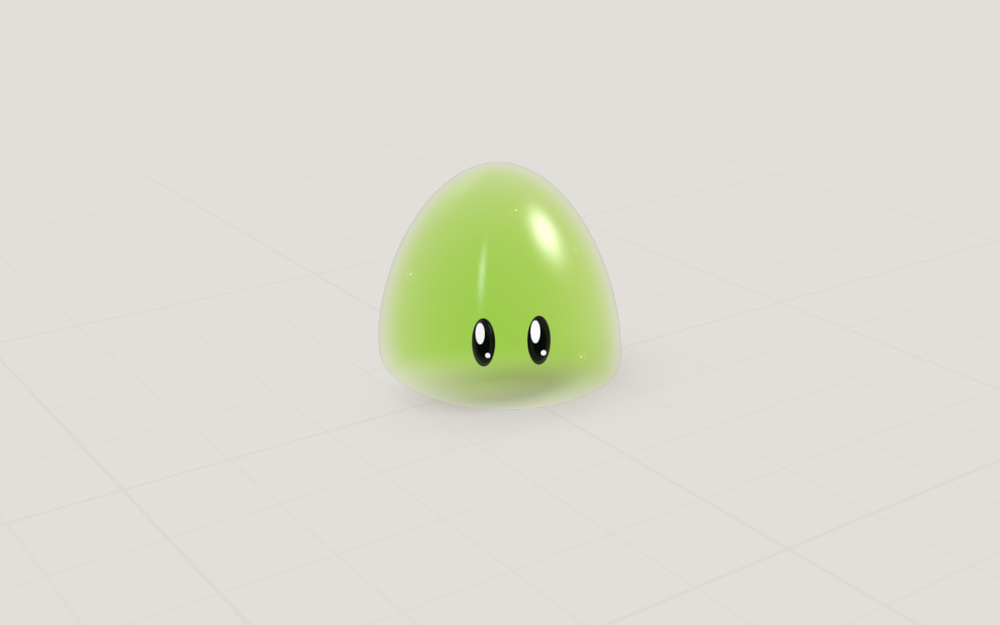
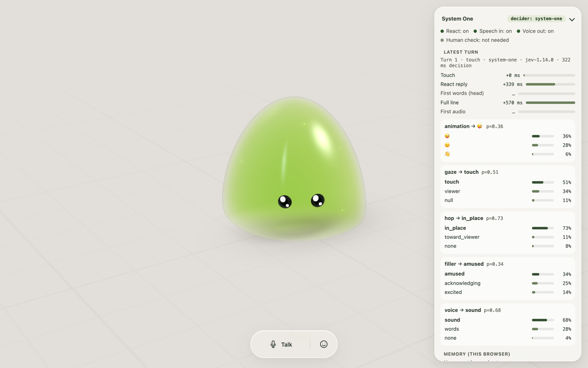
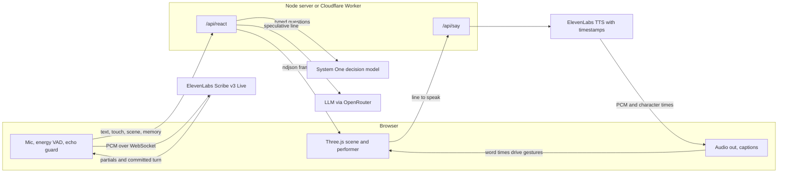

# Mintie



Mintie is an open-source talking slime-blob companion. They live in a Three.js (WebGL2) scene, react to touch, hear you through a realtime speech model, and answer in their own voice. The interesting part is how they decide what to do. A small typed-decision model ("System One") answers structured questions about each moment: which emote, where to look, whether to hop, whether to speak. A separate LLM only writes the words. A text-to-speech model supplies the voice and the per-character timing that lines gestures up with words.

The repo is a working showcase for System One and the companion to a blog post. It has no brand: any `/v1/systemone`-compatible decision model can be swapped in (the hosted Jev API, a self-hosted [OpenJev](https://huggingface.co/openjev/openjev), or another) by changing two environment variables.

Demo: https://mintie.sloprefinery.ai

## Quick start

Requires Node.js 24 or later and npm. No keys are needed.

```sh
npm ci
npm start
```

Open <http://127.0.0.1:8142/>.

With no keys, what works is:

- The scene: the jelly body, floor, contact shadow, idle life, eyes that follow the cursor.
- Touch: poke, pat, pet, lift, shake, throw. The physics runs locally and plays the bundled sound effects.
- Emotes: the emote picker plays any of the 64 catalogued gestures.
- The rules decider, a deterministic keyword-and-touch fallback in `server/rules.mjs`. `POST /api/react` answers with it when nothing else is configured:

  ```sh
  curl -s -X POST http://127.0.0.1:8142/api/react \
    -H 'content-type: application/json' -H 'origin: http://127.0.0.1:8142' \
    -d '{"text":"hola"}'
  ```

Voice does not work without keys. The browser app only calls `/api/react` when `/api/health` reports an LLM, so touch reactions and speech need at least an OpenRouter key; see [what each key turns on](docs/CONFIGURATION.md#what-each-key-turns-on).

Add `?debug` to the URL for an overlay that shows which decider answered, its per-option probabilities, a turn timeline and what Mintie remembers.



## Adding keys

Every key is optional and the server starts without any of them.

```sh
cp .env.example .env     # edit locally, never commit
node server/server.mjs --port 8142 --env-file .env
```

| Key | Provides | Get one |
| --- | --- | --- |
| `ELEVENLABS_API_KEY` | Speech in (Scribe v3 Live) and speech out (TTS with timestamps) | [elevenlabs.io](https://elevenlabs.io/) |
| `OPENROUTER_API_KEY` | The LLM that writes Mintie's lines | [openrouter.ai](https://openrouter.ai/) |
| `SYSTEM_ONE_API_KEY` (or `TYPESAFE_API_KEY`) | System One decisions | [docs.typesafe.ai](https://docs.typesafe.ai) |

Provider calls cost money. Use dedicated keys with provider-side spend limits. Full variable list, defaults and validation: [docs/CONFIGURATION.md](docs/CONFIGURATION.md).

## Architecture at a glance



The decision model, the LLM and the voice models each do one job; the browser stitches their outputs into one performance. The design, the turn lifecycle and the stream protocol are written up in [docs/ARCHITECTURE.md](docs/ARCHITECTURE.md).


## Documentation

- [Architecture](docs/ARCHITECTURE.md): turn lifecycle, System One, the decider chain, viewer awareness, rendering, stream protocol, the hosted guard.
- [Configuration](docs/CONFIGURATION.md): every environment variable, validation rules, running a local OpenJev.
- [Deploying](docs/DEPLOY.md): self-hosting on Cloudflare Workers with the spend guard.
- [Security](SECURITY.md): reporting, key handling, the guard model, memory privacy, CSP.
- [Assets](ASSETS.md): provenance of the bundled audio and third-party licenses.
- [Contributing](CONTRIBUTING.md): tests, checks, style.
- [SOUL](SOUL.md): Mintie's character prompt in readable form.

```sh
npm test       # unit tests, no network, no keys
npm run check  # browser checks; needs a Chromium, see CONTRIBUTING.md
```

## License

Source code is [MIT](LICENSE). The bundled MP3 recordings are covered separately; see [ASSETS.md](ASSETS.md). Three.js (MIT) and Playwright (Apache-2.0) keep their own licenses. OpenJev's weights, if you self-host them, are CC BY-NC 4.0 under their own model card.
