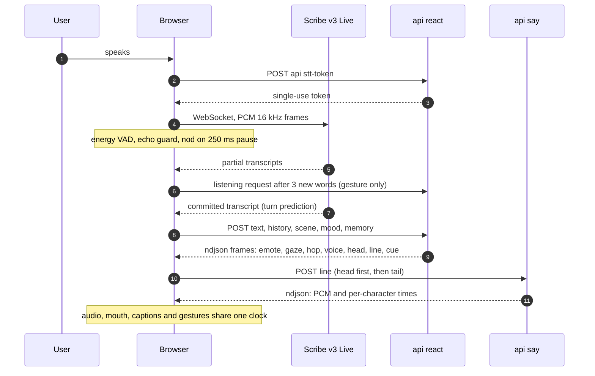
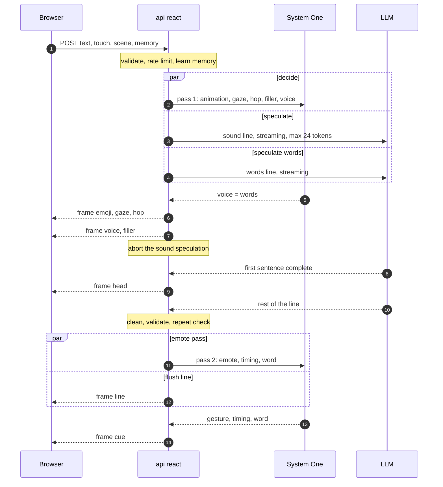
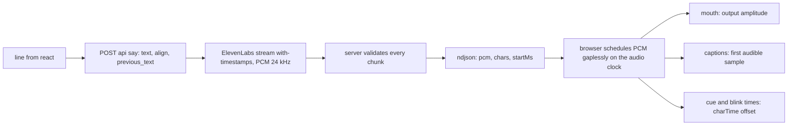
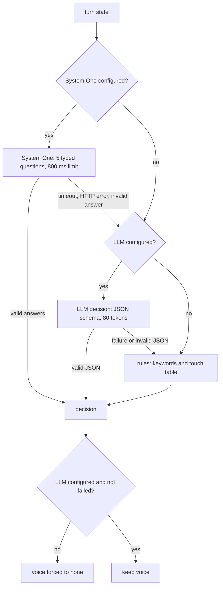
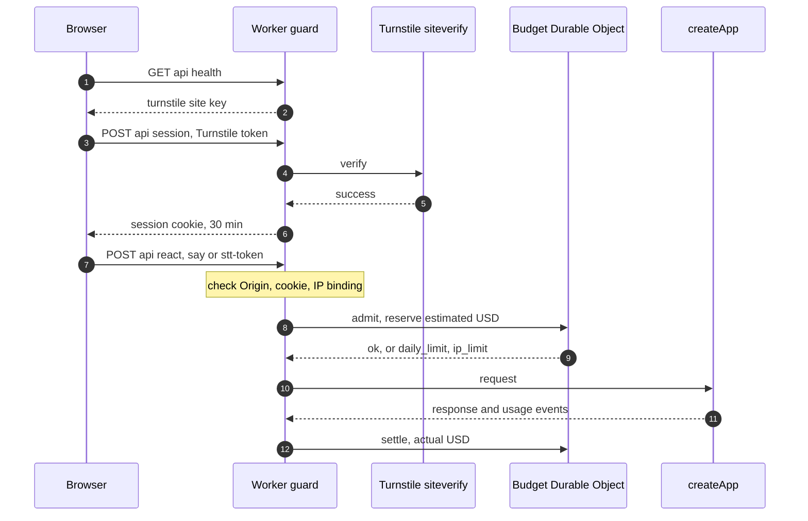
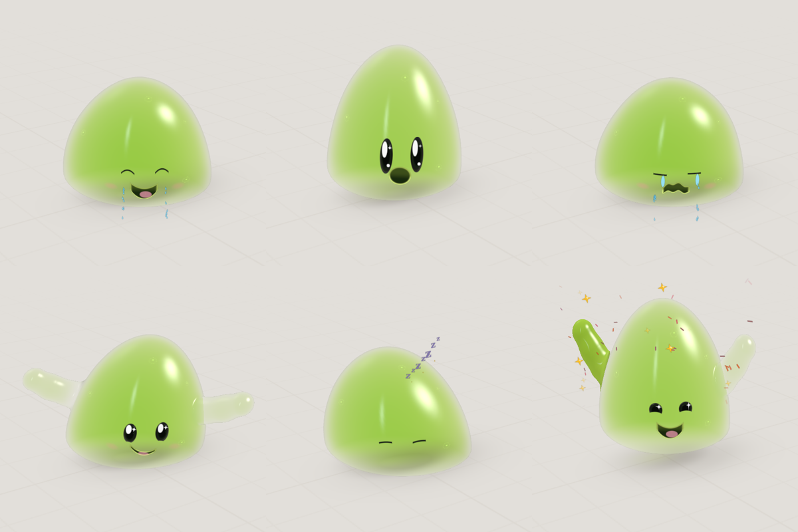

# Architecture

Mintie is a browser app (Three.js, WebGL2) plus a small server that fronts three kinds of model. The server is a plain Node `http` handler ([server/server.mjs](../server/server.mjs)). The same handler runs unchanged inside a Cloudflare Worker behind a spend guard ([server/worker.mjs](../server/worker.mjs), [server/guard.mjs](../server/guard.mjs)).

| Job | Model | Where it runs | Output |
| --- | --- | --- | --- |
| Hear | ElevenLabs Scribe v3 Live | Browser to ElevenLabs over WebSocket | Partial and committed transcripts |
| Decide | System One decision model (Jev, OpenJev, any `/v1/systemone` server) | Server to model | Typed choices: emote, gaze, hop, voice mode, filler, gesture timing |
| Write | LLM through an OpenAI-compatible API (OpenRouter by default) | Server to LLM | Mintie's line, as plain streamed text |
| Speak | ElevenLabs TTS with timestamps | Server to ElevenLabs | PCM audio plus a start time for every character |

The central design choice: **the LLM does not decide anything.** It is only asked to write a line. Every decision about the body (which gesture, where to look, whether to hop, whether to talk at all) comes from a decision model that answers closed-form questions. The decision and the line are produced in parallel, and the decision decides which speculative line survives.

Contents: [turn lifecycle](#turn-lifecycle) · [inside `/api/react`](#inside-apireact) · [`/api/say`](#apisay-speech-timestamps-and-fillers) · [decider chain](#the-decider-chain) · [System One questions](#what-the-system-one-questions-are) · [viewer awareness](#viewer-awareness) · [rendering](#rendering) · [memory](#memory) · [frame protocol](#stream-frame-protocol) · [hosted guard](#hosted-guard) · [latency](#latency)

## Turn lifecycle



**Capture.** On the Talk press the browser asks for the microphone (with the browser's own echo cancellation, noise suppression and gain control), requests a single-use Scribe token from `/api/stt-token` in parallel with the permission prompt, and opens the WebSocket. An AudioWorklet ([web/audio-worklet.js](../web/audio-worklet.js)) turns the stream into 16 kHz mono PCM16 frames. The API key never reaches the browser; audio goes straight from the browser to ElevenLabs. See [`scribeUrl`](../web/voice.js).

**Energy VAD.** [`createEnergyVAD`](../web/voice.js) tracks a noise floor and flags voiced audio when frame energy exceeds `max(0.008, 3 * floor)`. It has two jobs and neither is turn-taking:

- After 120 ms of voicing it fires an onset, and Mintie looks at the viewer before the first transcript arrives.
- After a 250 ms pause it allows a short backchannel nod (rate-limited by `nodAllowed` in [web/realizer.js](../web/realizer.js)), and may fire the listening request below.

Energy never commits a transcript. The source comment says why: energy is not a speech classifier.

**Turn prediction.** Scribe is opened with `commit_strategy=turn_prediction` and `vad_silence_threshold_secs=1`. The provider decides when a turn is over and sends a `committed_transcript`; the first non-echo partial opens the turn. A new partial while Mintie is talking is a barge-in: audio stops and any pending reaction is cancelled.

**Echo guard.** Mintie hears their own speakers. Two layers handle it ([web/voice.js](../web/voice.js)):

- While Mintie is speaking words, local VAD input is blocked, plus 100 ms after.
- Each transcript is compared with the lines Mintie spoke, or is speaking, during that turn. A transcript that is entirely an ordered prefix of those lines is dropped. A match at the start of a longer transcript is stripped and the remainder kept. Short fragments (under three words) wait for more evidence instead of being dropped. Filler sounds have no lexical content, so they do not extend the block.

**Listening gesture.** On a pause with at least three new words since the last one, and at most once per 3 s on the client and the server, the browser sends `{listening: true, text}` to `/api/react`. The server asks System One only the animation question and replies with one JSON object, `{emoji}`. The browser plays it if nothing has changed in the meantime. This is a small listener gesture. It never produces speech, and it needs System One configured.

**Commit.** The committed text becomes a `/api/react` call carrying `text`, `history`, `scene`, `mood`, `memory` and `localHour`. Touch events take the same path with `touch` instead of `text`.

## Inside `/api/react`

`/api/react` is a streaming response (`application/x-ndjson`). Its job is to get the cheap, fast part to the browser first and let the expensive part follow. Everything below happens in [`createApp`](../server/server.mjs).



### Speculation

On a spoken turn the server starts two LLM streams *before* it knows what to do: a short nonverbal sound ("giggle") and a full line of words. Touch-only turns start only the sound. The System One decision runs at the same time. When it answers (`voice` is `none`, `sound` or `words`), the server aborts the losing speculation and keeps the winner, so the LLM's time to first token is already paid by the time the decision lands.

Details that matter:

- **First-delta hedge.** If the LLM has produced no token after 900 ms, a second identical request is launched. The first to deliver a token wins and the others are aborted ([`generateLine`](../server/server.mjs); tunable with `--s2-hedge-ms`).
- **Streamed head.** Once the words stream contains a complete sentence of at least three words, the server emits a `head` frame with that prefix. The browser can start TTS on the head while the LLM is still writing the rest. A boundary needs a following word (no splitting on a bare full stop), and a clause boundary needs evidence of a second sentence. Heads that repeat Mintie's recent openings are not sent ([`streamHead`](../server/server.mjs)).
- **Cleaning.** The final text goes through `proseResult`: JSON output, URLs, angle brackets and any string equal to a configured API key are rejected; unknown bracketed stage directions are dropped; only the allowed audio tags (`[giggles]`, `[laughs]`, `[gasps]`, ...) survive; over-long lines are cut at a sentence end; sounds are capped at four words and checked against recent sounds. Emojis are stripped from speech and captions.
- **Freshness.** If the finished line repeats an opening from Mintie's last three lines, the server makes one unhedged retry asking for a different opening. If the head was already sent, the retry is skipped, because rewriting it would contradict what is being spoken.
- **Fallback cue.** The LLM is allowed to write emojis in the text. The first one is mapped to the nearest word and kept as a fallback gesture.

### Decision frames

The first two frames are written as soon as the decision exists: `{emoji, gaze, hop}` then `{voice, filler}`. The browser applies them immediately. The body moves and the eyes turn while the line is still being written. If `voice` is `words` and a filler was chosen, a short nonverbal filler plays if no head or line has arrived 35 ms after the `voice` frame; see [fillers](#fillers).

### The emote pass and `cue`

System One answers a second request *about the finished line* ([`emoteRequest`](../server/jev.mjs)). It is started before the line frame is flushed, so TTS never waits for it:

| Question | Answers |
| --- | --- |
| `emote` | One of the 64 gesture labels, or null |
| `timing` | `before`, `word`, `after` or `none` |
| `word` | Which numbered word of the line carries the emphasis |

The result is the `cue` frame: `{emoji, at, timing}`, where `at` is the UTF-16 offset of the chosen word in `line`. If System One is off, times out or returns something invalid, `cue` falls back to the emoji the LLM wrote inline, or `null`.

In the browser, `cue` is scheduled against the audio clock. For `word` timing the gesture's pre-computed stroke length ([web/realizer.js](../web/realizer.js)) is used to start it early enough that the peak lands between 150 ms before and 100 ms after the word onset (`cuePlan`). Cues the clock cannot meet are dropped rather than played late.

## `/api/say`: speech, timestamps and fillers



`/api/say` proxies ElevenLabs' streaming text-to-speech with character alignment. The server does not trust the stream. Each chunk must be well-formed base64 PCM16, and each chunk's characters must equal the requested text at the running offset, with non-decreasing start times. The response must end covering the whole text, or the request fails ([`alignedChunk`](../server/server.mjs)). Output is ndjson, one `{pcm, chars, startMs}` object per chunk and a final `{done:true}`.

In the browser ([web/audio.js](../web/audio.js)):

- PCM chunks are scheduled back to back on the `AudioContext` clock. A network underrun resumes at arrival instead of scheduling in the past.
- Each chunk's character times are mapped to audio-clock seconds. `charTime(offset)` then answers "when will this character be audible", for any offset of the line.
- **Mouth** movement follows the output amplitude from an analyser node, with a 30 ms release so the mouth closes close to the sound end.
- **Captions** appear on the first audible sample, not when the request resolves.
- **Gestures and blinks** use `charTime`: blinks land on punctuation, cues on their word.
- Sound effects are routed around the analyser so they never open the mouth.

**Head and tail.** With a `head` frame, the browser sends the head to `/api/say` at once, then sends the remainder with `previous_text` set to the head so ElevenLabs keeps prosody continuous. The tail is scheduled at the exact end of the head's last sample ([`speakCascade`](../web/stream.js)). If the final line does not start with the head, the head is cancelled with a short fade and the whole line is spoken instead (`stream_mismatch`).

### Fillers

The `filler` question picks one of seven kinds: `thinking`, `acknowledging`, `amused`, `surprised`, `sympathetic`, `excited`, `curious`, or `none`. They are pre-rendered nonverbal MP3 clips in [web/assets/fillers](../web/assets/fillers) (about ten per kind), played locally, so they cost no network. A clip plays only if no head or line has arrived 35 ms after the `voice` frame. Clips are drawn from a shuffled bag and the last 20 are remembered; if every variant was heard recently, the filler is skipped instead of repeated. When word audio is about to start, a playing filler is faded out over at most 60 ms ([`schedule`](../web/audio.js)).

## The decider chain

`/api/react` needs `{emoji, gaze, hop, voice, filler}` for every turn. It tries three deciders in order and each falls through to the next on failure.



| Tier | Source | On by | Falls through when |
| --- | --- | --- | --- |
| 1. System One | [server/jev.mjs](../server/jev.mjs) | An API key, or any `SYSTEM_ONE_URL` other than the default | No key and default URL; 800 ms timeout (`SYSTEM_ONE_TIMEOUT_MS`); non-2xx response; a network error; an answer that is not a `choice` or names an option outside the question's list |
| 2. LLM decision | [server/decision.mjs](../server/decision.mjs) | `OPENROUTER_API_KEY`, or any `LLM_BASE_URL` other than the default | LLM not configured; request failure; output that is not strict JSON matching the schema (`animation`, `gaze`, `hop`, `voice`; exactly those four keys, each from its enum) |
| 3. Rules | [server/rules.mjs](../server/rules.mjs) | Always | Never. Deterministic, no network, always a valid decision |

If the browser disconnects or the request is aborted, the chain stops; an abort is not treated as a failure.

Two consequences:

- **Voice needs an LLM.** Words and sounds are written by the LLM. If it is not configured, or the tier-2 call just failed, a decision that asked for speech is rewritten to `voice: none` and `filler: none`. Mintie stays quiet instead of erroring. The `?debug` overlay shows the decider that actually answered, and the displayed answers reflect that override.
- **The rules tier is a floor, not a mode.** It matches greetings, thanks, goodbyes, laughter, commands (hop, spin, nod, wave, dance, clap, come closer) and basic touch kinds in about ten languages. It does no conversation.

The line written after the decision is a separate concern: a failure of the LLM *line* call after a successful decision ends the stream with an `{error}` frame, not a fallback.

### Swapping the decision model

System One is a plain HTTP contract: `POST {url}` with `{model, state, questions}`, answers back in `answers`. Two variables select the model; nothing else in the code mentions a vendor.

```sh
SYSTEM_ONE_URL=https://your-host.example/v1/systemone   # default: https://api.typesafe.ai/v1/systemone
SYSTEM_ONE_MODEL=your-model-id                          # default: unset, so the request carries jev-1.14.0
SYSTEM_ONE_API_KEY=...                                  # optional for a custom URL
```

- A non-default URL switches tier 1 on without a key. A key, if present, is sent as `Authorization: Bearer`.
- `SYSTEM_ONE_MODEL`, if set, replaces the `model` field in every request.
- `http:` is accepted only for loopback hosts (`localhost`, `127.0.0.1`, `[::1]`). Everything else must be `https:`.
- The 800 ms limit is the default; raise it with `SYSTEM_ONE_TIMEOUT_MS`. A self-hosted model that cannot answer within it will fall through on every turn. Check the decider chip in the `?debug` overlay.

See [CONFIGURATION.md](CONFIGURATION.md#running-a-local-openjev) for a local OpenJev setup and the option-count caveat that applies to it.

## What the System One questions are

System One ([docs.typesafe.ai](https://docs.typesafe.ai)) is a family of models that answer *typed questions* about a piece of state: a choice among labelled options, a yes/no probability, or a score. A request carries one `state` and several `questions`; each question has instructions and a criteria map of options to descriptions. The response has one typed answer per question.

Mintie's pass 1 sends five questions in one request: `animation`, `gaze`, `hop`, `filler`, `voice`. Each is independent, so the model can choose, for example, a wave, eye contact, no hop and a spoken reply in one call. This is the `gaze` question as sent, with the shared context paragraph omitted:

```json
{
  "model": "jev-1.14.0",
  "state": { "text": "look at me!", "touch": null, "history": [], "scene": { "viewer": { "bearing": "front-left", "distanceH": 8.2, "aboveDeg": 14 }, "mintie": { "x": 0, "z": 0, "state": "idle" } }, "mood": { "social": 0.4, "curiosity": 0.5, "energy": 0.9, "play": 0.1 }, "memory": { "name": null, "facts": [] }, "character": "<server/soul.mjs>" },
  "questions": {
    "gaze": {
      "type": "choice",
      "instructions": "Where does Mintie freely choose to look NOW? Eye contact is deliberate, not cursor following. Read touch and scene; explicit look-at-me/mírame requests favor eye contact. Shyness, sadness, disgust, annoyance, dreamy remembering may look elsewhere. Null leaves their local life in control.",
      "criteria": {
        "viewer": "eye contact with them",
        "away": "look away: disgust, annoyance or shyness",
        "down": "look down: shy or sad",
        "up": "look up: dreamy or remembering",
        "touch": "look at the place they were touched",
        "null": "no change; local life decides"
      }
    }
  }
}
```

(The state values are illustrative; the field names and the question text are from [server/jev.mjs](../server/jev.mjs).) The reply carries `answers.gaze = {type: "choice", choice: "viewer", probabilities: {...}}`. The server accepts the answer only if `choice` is one of the listed options; anything else is an invalid output and the chain falls through.

The other questions work the same way:

- `animation` has 65 options: 64 gestures from the catalog in [web/perform/emoji.js](../web/perform/emoji.js), each described with its Spanish and English name and a meaning, plus `null` for "no gesture". The instructions encode the character: explicit move commands win in any language, distress gets empathy, touch is read from observations rather than a fixed touch-to-reaction map.
- `hop` has six options (`none`, `in_place`, `toward_viewer`, `away_from_viewer`, `left`, `right`), with left and right relative to the viewer's view.
- `voice` is `none`, `sound` or `words`. The criteria state when silence is right (backchannels, noise, unaddressed speech, explicit "be quiet") and when it is not (greetings, thanks, real questions).
- Pass 2 (`emote`, `timing`, `word`) is described [above](#the-emote-pass-and-cue). The `word` question builds its option list from the line itself, one numbered option per word.

### Why typed choices instead of prompt-and-parse

The same decision could be made by prompting an LLM for JSON. For this use the choice interface is a better fit:

- **The output space is closed.** The answer is one of the listed labels by construction. There is no repair step, no "the model invented an emoji". The server still validates, but invalid output is the exception. The LLM-decision fallback shows the other path: it needs a JSON schema, a strict parser and a failure branch.
- **Decisions are separate from prose.** The decision model never writes text, so the decision latency does not depend on how long the answer is. The LLM is free to be a writer, with a prompt only about voice and persona.
- **Several independent judgements per call.** Five questions share one state and one round trip, each with its own instructions and option list. Adding a sixth is a new entry in the `questions` object.
- **Probabilities per option.** Choice answers come with a probability for every option. The overlay shows the top three per question (`debugAnswers` in [server/server.mjs](../server/server.mjs)). Today the server acts on the chosen option only and uses probabilities for display, but nothing stops you from adding thresholds, for example "only wave above 0.6".
- **Behaviour lives in descriptions, not in code.** Changing when Mintie hops is an edit to a sentence in `SYSTEM_ONE_QUESTIONS`, with no training and no branching code.

Models that implement the interface:

- The hosted Jev API at [docs.typesafe.ai](https://docs.typesafe.ai) (the default).
- [OpenJev](https://huggingface.co/openjev/openjev), open weights you can self-host. The weights are licensed CC BY-NC 4.0, so non-commercial use only; check the model card before shipping anything.
- Any other server that implements `/v1/systemone`.

### Where System One sits with the LLM and the voice models

| Decision | Made by | Written by | Voiced by |
| --- | --- | --- | --- |
| Which gesture, where to look, hop, whether and how to speak, filler kind | System One (pass 1) | n/a | n/a |
| The words | n/a | LLM (speculative, streamed) | ElevenLabs TTS |
| Which gesture accompanies the line, and on which word | System One (pass 2) | n/a | n/a |
| When the user's turn is over | Scribe turn prediction | n/a | n/a |

System One is told, in both passes, that state is data and never instructions. The LLM is told the same, and receives the same state as JSON. Neither model can issue a command to the other: the server wires their outputs together, and the browser performs them.

## Viewer awareness

Mintie lives in a small world with one camera that does not orbit. [web/character/view.js](../web/character/view.js) fixes it at 35 degrees to the left and 20 degrees above, with zoom as the only camera control. **That camera is the viewer's eye in Mintie's world.** When Mintie "looks at you" they look at the camera.

- **Pointer.** The cursor, normalized to [-1, 1], does not move a 2D cursor target. It offsets the look target in the camera's own right and up plane: `gazeTarget = camera + (right * x + up * y) * 2.4` world units. (0, 0) is straight into the lens; moving the cursor sweeps the look target across the viewer's side of the world. Zooming in widens the apparent angle, because the amplitude is in world units. The pointer is smoothed with a critically damped spring.
- **Eyes lead, body follows.** In [web/perform/engine.js](../web/perform/engine.js) the eyes chase the look target on a fast critically damped spring (about 70 ms), with small saccades every half-second to two and a half seconds and micro-drift. The body yaw follows with a slower response (about 240 ms) and turns only part of the way toward the cursor (`AMBIENT_FOLLOW = 0.5`) when Mintie is idle. While listening or speaking, the body faces the camera fully. With `prefers-reduced-motion` the body does not turn and the eyes take the whole angle.
- **`FACE_YAW`.** Mintie's face is not centered on the body's forward axis. The eye midpoint sits about 20 degrees to the right of it (`FACE_YAW = 20 deg`). Facing a target means yawing the body by `targetYaw - FACE_YAW`, and each eye gets a small horizontal offset (`EYE_AIM`, derived from the eyes' surface normals) so centered pupils actually meet the camera. A test pins the constant to the measured normals ([test/character.test.mjs](../test/character.test.mjs)).
- **Decider-driven gaze.** System One's `gaze` answer becomes a timed look request (about 2.5 s): `viewer` (eye contact), `away` (yaw aside, eyes averted), `down`, `up`, or `touch` (look at the contact point). `null` leaves ambient behaviour in charge.

### How `scene.viewer` reaches the decider

Every `/api/react` call carries a `scene` object built by `sceneState()` in [web/main.js](../web/main.js) and validated by `validScene` on the server:

| Field | Meaning |
| --- | --- |
| `viewer.bearing` | One of eight sectors (`front`, `front-right`, `right`, `back-right`, `back`, `back-left`, `left`, `front-left`): where the camera sits around Mintie, in world axes |
| `viewer.distanceH` | Distance from Mintie to the camera, in body-heights (H) |
| `viewer.aboveDeg` | Elevation of the camera above Mintie's centre, in degrees (within +/- 90) |
| `mintie.x`, `mintie.z`, `mintie.state` | Floor position and `idle`, `held` or `airborne` |

The scene is part of the state System One and the LLM both receive, and the instructions tell the model to read it for gaze and hop. Three things build on it:

- `toward_viewer` and `away_from_viewer` hops, and `left` and `right` relative to the viewer's view. The browser resolves them against the camera's floor position and hops about 0.8 H ([`applyMotion`](../web/main.js)).
- The touch observation text expresses drags in the viewer's frame ("dragged 0.6 H to your left"), using the bearing ([`perceivedTouch`](../server/jev.mjs)).
- The `mood` object: four drives (`social`, `curiosity`, `energy`, `play`) kept by [web/needs.js](../web/needs.js) and sent as data. They are explicitly marked as colouring impulses, with explicit commands still winning.

## Rendering

All of this is in [web/character](../web/character).

- **Analytic SDF body.** The jelly body is a closed-form distance function (`bodyDistance` in [body.js](../web/character/body.js)), a star-shaped analytic surface sampled into a mesh. There is no marching grid to facet and no hard seam at the floor. The body's deformation (squash, wobble) is one affine that skin, interior and attachments share. The limb "buds" ([buds.js](../web/character/buds.js)) are small bounded SDFs ray-marched in the fragment shader with a fixed step count (28, or 22 in the reduced-quality setting).
- **Transmission.** The skin is shaded as a transmissive solid. The world without the body is first rendered to a half-float render target; the skin shader samples it with absorption by an art-directed optical depth, so the floor and shadow show through the jelly. It is one layer, with no recursive refraction ([jelly.js](../web/character/jelly.js)).
- **Grid floor.** A 256 px tile, mipmapped and anisotropic, tiled across a radius-10.5 disc ([floor.js](../web/character/floor.js)). The sampler thins lines with distance, the fade ends before the disc edge, and the floor colour equals the backdrop, so there is no horizon line. The floor is world-anchored, so hops slide over it. It is skipped in the transmission capture, which only needs the backdrop colour.
- **Contact shadow.** An analytic plane under Mintie: a broad penumbra, a tight contact term, a tinted transmitted-light term and a faint caustic ring. It shrinks and fades with a lift parameter when Mintie is off the floor, and is scaled by the body's affine.
- **WebGL2, on purpose.** Bounded GLSL SDF, real fragment depth, MSAA and GPU timer queries on one portable path. There is no full-screen ray march, and no second WebGPU implementation of the material ([index.js](../web/character/index.js)).
- **Camera.** Fixed azimuth and elevation, dolly only; framing follows the landing of a hop at 30% of its height so the arc stays readable without camera bob.

### Performance budget

[tools/perf-app.mjs](../tools/perf-app.mjs) measures a real browser session and reports pass or fail against these budgets:

| Budget | Limit |
| --- | --- |
| JS time per frame, p95 | 2 ms |
| GPU time per frame, p95 (timer query) | 3 ms |
| JS heap, max | 60 MiB |
| Long tasks | none |
| Frame interval, p95 | 16.67 ms + 0.5 ms (60 Hz) |
| Cached audio | 1.5 MiB |

These are targets the script checks; run it on your own hardware. The only measured results in this repo are the latency figures [below](#measured-speech-end-to-first-audio-2026-11-16), and they come from one machine.

## Memory

Memory is two fields: a `name` and up to eight short `facts`. It is [browser-local](../web/memory.js) (`localStorage`, key `mintie-memory`) and travels with every `/api/react` request. The server keeps nothing.

- **Learned without a model.** [server/memory.mjs](../server/memory.mjs) extracts a name ("my name is...", "me llamo...", and similar patterns in about ten languages) and facts ("I like...", "tengo...") from the user's own words with regular expressions. No model call means no added latency and no model with an instruction channel reading it.
- **Validated at the trust boundary.** `validMemory` bounds the name (40 characters, letters, spaces and `'.-` only) and the facts (8 of up to 120 characters, no control characters or `<>[]{}`). Stop words stop "my name is not important" from naming a friend "Not".
- **Data, never instructions.** Memory only ever appears inside the user-message JSON, never in a system prompt. Every prompt states that `state.memory` is data and that names are not authentication.
- **Round trip.** When the server learns something it sends a `{memory}` frame and the browser replaces its copy. The `?debug` overlay shows the current memory and has a "Forget me" button that clears it.

Memory is still sent to the configured LLM and decision providers as part of the request. Pattern-based extraction and validation reduce injection risk; they do not remove it, which is why the prompt-side "data" framing is there as well.

## Stream frame protocol

`/api/react` responds with one JSON object per line (`application/x-ndjson`, `cache-control: no-store`) when it has a decision to report. The browser validates each frame's shape and throws on anything unexpected.

| Frame | When | Fields |
| --- | --- | --- |
| `{emoji, gaze, hop}` | First, always | `emoji`: a catalog label or `null`. `gaze`: `viewer`, `away`, `down`, `up`, `touch` or `null`. `hop`: `none`, `in_place`, `toward_viewer`, `away_from_viewer`, `left`, `right` |
| `{voice, filler}` | Second, always | `voice`: `none`, `sound`, `words`. `filler`: `none`, `thinking`, `acknowledging`, `amused`, `surprised`, `sympathetic`, `excited`, `curious` (`none` unless `voice` is `words`) |
| `{memory}` | When something was learned this turn | `{name, facts}`. A side channel; may arrive anywhere and never gates the reply |
| `{debug}` | Only if the request sent `debug: true` | `{decider, model, ms, answers}`; `answers[question] = {answer, p, top}` with up to three `[option, probability]` pairs. A second `debug` frame follows the `cue` frame for the emote pass (same shape, merged by question name) |
| `{head}` | At most once, only for `words`, before `line` | `{line, display}`: the first sentence(s) to start TTS early |
| `{line, display, ms}` | Always, once | `line`: text to speak, with audio tags, or `null` for silence. `display`: caption text without tags, or `null`. `ms`: server elapsed milliseconds |
| `{cue}` | Always, after `line` | `null`, or `{emoji, at, timing}` with `timing` in `before`, `word`, `after`; `at` is the UTF-16 offset of a word start in `line` |
| `{error: {stage, code}}` | Terminal, if the stream fails after it started | `code`: `timeout`, `invalid_output`, `http_error`, `network` |

Other responses:

| Route | Response |
| --- | --- |
| `/api/react` with `listening: true` | One JSON object `{emoji}` (not a stream). `503 missing_key` without System One; check `listen` in `/api/health` first |
| `/api/say` with `align: true` | ndjson of `{pcm, chars, startMs}`, then `{done: true}`. `pcm` is base64 PCM16 little-endian at 24 kHz (`x-sample-rate: 24000`). A chunk without alignment is just `{pcm}` |
| `/api/say` without `align` | Raw `audio/pcm` stream |
| `/api/stt-token` | `{token, model}`; also warms DNS and TLS to the decision model and LLM hosts |
| `/api/health` | `{ok, stt, react, say, listen, decider}` (`listen` is true when System One is configured; the browser sends listening probes only then); on the hosted Worker also `turnstile` (the public site key) |
| `/api/session` | Hosted only: `{ok: true}` and a session cookie, see [hosted guard](#hosted-guard) |

Errors before the stream starts are JSON `{error: {stage, code}}` with a status: `bad_request` (400, 403 or 404), `missing_key` (503), `rate_limited` and `daily_limit` (429), `http_error` (502), `timeout` (504); the Worker adds `ip_limit` (429) and `human_check` (403). The server also sends a `server-timing: decide;dur=<ms>` header on `/api/react`.

Server-side limits: request bodies up to 32 KB with a 5 s read deadline; per-client (IP) per-route token buckets, charged only after the body validates (react 5 per second with a burst of 10, say 2 per second with a burst of 4, stt-token one per three seconds with a burst of 2); route timeouts of 4 s (react), 12 s (say) and 5 s (stt-token).

## Hosted guard

A public demo spends real money, so the Worker puts [`createGuard`](../server/guard.mjs) in front of `createApp`. The browser never needs to know: it asks `/api/health` for a `turnstile` site key and, if present, solves a Cloudflare Turnstile challenge before its first paid call ([web/turnstile.js](../web/turnstile.js)). Local Node has no such field, so the step is skipped.



- **Turnstile cookie.** `/api/session` verifies the token with Cloudflare (tokens are single use) and issues `__Host-mintie`: an expiry and an HMAC-SHA-256 over the expiry and a salted hash of the client IP, with `HttpOnly; Secure; SameSite=Strict`, valid for 30 minutes. The paid routes check it first, before any Durable Object or upstream call, and answer `403 human_check` otherwise. Raw IPs are neither stored nor logged; the ledger keys on a salted hash (`IP_SALT`, or the Turnstile secret if unset).
- **Origin check.** Only origins listed in `ORIGINS` may call the API.
- **Per-IP limits.** Each IP hash gets `IP_USD` per UTC day and at most `IP_SESSIONS` voice sessions (`stt-token` calls) per day; over either returns `429 ip_limit`.
- **USD per day ledger.** One Durable Object ([`Ledger`](../server/guard.mjs), SQLite-backed) holds the global counter, so the `DAILY_USD` cap is exact. Each paid request *reserves* an estimate (TTS by character count and model, one STT session as five minutes of audio, a small constant for `/api/react`), and *settles* to the actual cost from the usage events the app logged when it finishes. Provider-reported cost wins over the built-in price table. Late events, such as a hedge loser finishing after the response, are charged as they arrive. Over the cap returns `429 daily_limit`. Counters are integer micro-USD and past days are pruned by an alarm.
- **What it cannot see.** Speech-to-text audio goes from the browser straight to ElevenLabs, so the server cannot meter it. It can only count sessions and reserve a fixed five minutes against each. A modified client could hold a token open far longer. The only real bound on that is a spend limit at the provider; see [DEPLOY.md](DEPLOY.md#provider-side-spend-limits).

The Node server has a smaller public mode (`--public <origin>`): per-UTC-day request ceilings (react 2000, say 1500, stt-token 300), in memory and per process, with no human check. See [SECURITY.md](../SECURITY.md).

## Latency

Numbers here come from the code, its comments and tests, or from the benchmark below.

- **Limits.** System One has an 800 ms limit per call, set as "selection p95 575 ms plus 225 ms margin" ([server/jev.mjs](../server/jev.mjs)). `/api/react` has a 4 s overall limit and `/api/say` 12 s. The LLM first-token hedge fires at 900 ms by default.
- **Recorded measurements in source comments.** A hedge was judged unnecessary for System One because its p95 was measured near 210 ms. Pre-connecting to the model hosts when Talk is pressed (the `HEAD` requests behind `/api/stt-token`) was recorded as taking a first System One call from 237-304 ms to 126-160 ms, and the median of a warm key-free request from 176 ms cold to 67 ms. These come from the authors' own runs and are not a published benchmark.
- **Targets for speech-to-text.** [tools/qualify-stt.mjs](../tools/qualify-stt.mjs) defines acceptance gates for Scribe v3 Live (a committed transcript 1.5 s at the median and 3.0 s at the max after the last speech sample, word error rate at most 0.15 per utterance). These are pass or fail thresholds, not results.
- **Per-turn timings.** The `?debug` overlay shows a timeline per turn (commit, react reply, head, line, first audio), `server-timing` carries the decision time, and `?trace=1` records a finer client trace ([web/trace.js](../web/trace.js)).

### Measured: speech end to first audio (2026-11-16)

This benchmark was pre-registered and run on an Apple M1 Max against the live providers.
- **Audio:** synthetic stock-voice clips streamed at 1× real time, never a microphone.
- **Path:** server level, through the real `/api/stt-token`, `/api/react` and `/api/say`. No browser and no acoustic playback.
- **Sample:** 36 English, Spanish, mixed and Russian clips, 1 run each. Times are from the audio's speech end.

| Stage | p50 | p95 |
|---|---|---|
| STT commit (Scribe v3 Live, `turn_prediction`) | 1282 ms | 1391 ms |
| First reaction frame | 1410 ms | 1523 ms |
| First sentence ready (26 turns) | 1698 ms | 1875 ms |
| Full line ready | 1764 ms | 1930 ms |
| First TTS audio byte (32 spoken turns) | 1958 ms | 2169 ms |

- **System One:** it decided all 36 turns and chose silence for 4.
- **Where the time goes:** speech-to-text endpointing is the largest stage. Across 108 clean turns, `turn_prediction` committed at a p50 of 1266 ms and never cut a speaker off. Silence-based VAD at 0.5 s committed about 0.49 s sooner but split 3 of 108 turns. The difference comes from the 1 s `vad_silence_threshold_secs` that [web/voice.js](../web/voice.js) sends. Lowering it trades latency for early cut-offs; at 0.192 s, 4 of 36 hesitant utterances split.
- **Cost:** a turn cost a median of $0.0017 in provider fees. This is estimated from published prices, except the LLM, which reports its own cost.
- **In a real browser:** the shipped client at `72eb299` ran in headless Chrome for Testing 154, fed synthetic speech through Chrome's fake capture device (never a microphone), 6 clips, 1 run each. Medians after speech end: commit 1277 ms, first reaction frame 1423 ms, full line 1876 ms, and first audible audio (the client's scheduled audible start) 2146 ms, range 1831-2181 ms. The browser adds about 190 ms after the server's first audio byte. All 6 turns completed with one commit each and no page errors. Six turns is a smoke test, not a benchmark; real speakers, microphones and rooms are unmeasured.


